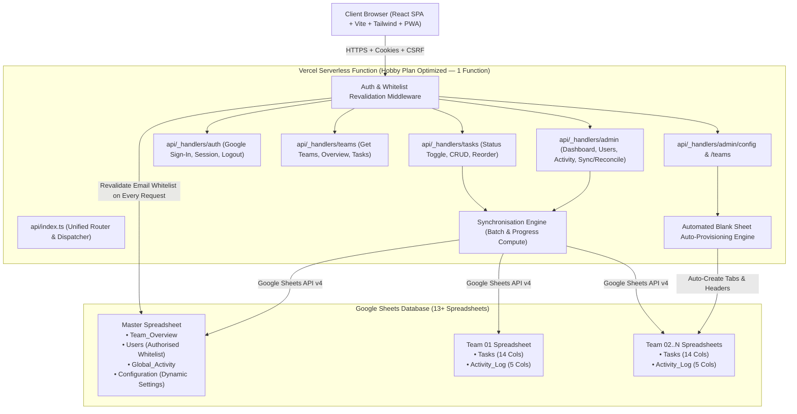

# KRITI Tracker: Kakatiya Research Initiative for Transformative Innovation

<div align="center">

[](LICENSE)
[](https://www.typescriptlang.org/)
[](https://react.dev/)
[](https://tailwindcss.com/)
[](https://developers.google.com/sheets/api)
[](https://web.dev/explore/progressive-web-apps)
[-emerald)](https://web.dev/cls/)
[](https://www.w3.org/WAI/standards-guidelines/wcag/)

**A production-ready, full-stack responsive web application tracking progress across 12 clinical congress committees and teams (dynamically extensible beyond 12), with isolated medical committee checklists, prominent latest-pending-task workflow, executive administrative monitoring dashboard, Dynamic Admin Control Centre, mandatory email whitelisting, interactive MIT License Modal, and Google Sheets as the primary database.**

[Live Deployment Guide](DEPLOYMENT_GUIDE.md) • [Architecture](#-system-architecture) • [Two-Tier Navbar](#-two-tier-navigation-bar-arrangement) • [12 Committees](#-12-medical-congress-committees) • [Quickstart](#-quickstart-in-3-minutes) • [License](#-license--attribution)

</div>

---

## 📑 Table of Contents

- [🌟 Key Highlights & Features](#-key-highlights--features)
- [🏛️ Two-Tier Navigation Bar Arrangement (Zero CLS)](#-two-tier-navigation-bar-arrangement-zero-cls)
- [🏥 12 Medical Congress Committees](#-12-medical-congress-committees)
- [🏗️ System Architecture](#-system-architecture)
- [🚀 Automated Blank Sheet Auto-Provisioning Engine](#-automated-blank-sheet-auto-provisioning-engine)
- [📱 Mobile Viewport & PWA Optimization](#-mobile-viewport--pwa-optimization)
- [⚡ Quickstart in 3 Minutes](#-quickstart-in-3-minutes)
- [📁 Repository Structure](#-repository-structure)
- [🔒 Security, Whitelisting & Privacy Governance](#-security-whitelisting--privacy-governance)
- [🧪 Local Testing & Zero-Leak Sandbox](#-local-testing--zero-leak-sandbox)
- [☁️ Production Deployment to Vercel](#️-production-deployment-to-vercel)
- [📄 License & Attribution](#-license--attribution)

---

## 🌟 Key Highlights & Features

1. **13+ Independent Google Sheets Database:**
   - **1 Master Spreadsheet:** Contains `Team_Overview`, `Users` (Authorised User Whitelist), `Global_Activity`, and `Configuration` (Dynamic Settings).
   - **12+ Individual Committee Spreadsheets:** Each contains a dedicated `Tasks` sheet (clinical priority, deadline, status, category, mandatory flag) and an `Activity_Log` audit sheet.
   - Zero reliance on `IMPORTRANGE` — synchronization is performed atomically by the backend via Google Sheets API v4 with optimistic client updates.
2. **Automated Blank Sheet Auto-Provisioning:**
   - Add any freshly created blank Google Spreadsheet via the Admin Control Centre. The system automatically inspects sheet metadata, creates missing `Tasks` and `Activity_Log` tabs, and seeds 14-column task schemas and 5-column audit headers on the fly.
3. **Mandatory Institutional Email Whitelisting:**
   - Google Sign-In is required, but Google authentication alone **never** grants access.
   - Tokens are validated server-side (`email_verified === true`, aud, iss, exp).
   - Only pre-authorized institutional emails in the Master `Users` spreadsheet obtain an active session.
   - Revalidated on **every authenticated backend request** — revoked emails lose access immediately.
4. **Zero-CLS Two-Tier Navigation Architecture:**
   - Inspired by the clean arrangement of [Canonify](https://deekshithvodela.github.io/canonify/), the header is organized into two pre-allocated tiers:
     - **Tier 1 (Utility & Status Bar, 32px fixed):** Dynamic clinical announcement ticker or live synchronization status, plus compact QA Persona Switcher. Pre-allocated height guarantees 0 Cumulative Layout Shift.
     - **Tier 2 (Main Brand & Navigation Bar, 56px fixed):** Brand monogram squircle ('K'), navigation links, user profile dropdown, and mobile drawer toggle.
5. **Mobile-First Responsive Experience:**
   - Screen real estate maximized on mobile by isolating the global footer strictly to `/login`.
   - Deliverable checklist cards feature structured row hierarchies (title, priority badge, metadata) and >= 44x44px touch targets.
   - Smooth horizontal swipe filters and slide-down mobile navigation drawer with legal compliance modals.
6. **Executive Admin Dashboard & Control Centre:**
   - Centralized visibility across all 12 medical event committees with real-time completion progress bars, overdue warnings, and 1-click **Force Reconcile**.
   - Dynamic team creation, renaming, category customization, widget toggling, and branding governance without touching source code.
7. **Strict Role-Based Access Control (RBAC):**
   - **Super Admin (Congress Director):** Global access, task CRUD, reordering, whitelist administration, reconciliation.
   - **Team Head (Committee Chair):** Isolated strictly to their assigned committee. Cross-team requests are blocked with 403 Forbidden.
   - **Viewer (Ethics Auditor):** Read-only visibility for compliance auditing.

---

## 🏛️ Two-Tier Navigation Bar Arrangement (Zero CLS)

To eliminate Cumulative Layout Shift (CLS) caused by dynamic asynchronous announcements and to keep small mobile viewports completely uncluttered, KRITI MedEvent Tracker implements a strict two-tier navigation structure:

```
+-----------------------------------------------------------------------------------------+
| TIER 1: UTILITY & STATUS BAR (Fixed h-8 / 32px height • Dark Navy #0f172a • Zero CLS)   |
| [● LIVE] 🩺 Medical Congress Active • Live Multi-Committee Sync        [🧪 QA: Director ▾]|
+-----------------------------------------------------------------------------------------+
| TIER 2: MAIN BRAND & NAVIGATION BAR (Fixed h-14 / 56px height • White Backdrop-Blur)     |
| [K] KRITI            |  Overview  •  Control Centre  •  Users      [Avatar (D) ▾]  [☰]  |
+-----------------------------------------------------------------------------------------+
```

### Why This Architecture Wins
- **Zero Layout Shift (CLS = 0.00):** In traditional single-row headers, an asynchronous announcement banner pops in above the navigation bar after loading, jarringly shifting page content downward by 32px. In our two-tier arrangement, Tier 1 is **pre-allocated in the DOM with a fixed 32px height**. Whether showing the live clinical status ticker or an admin broadcast, height never changes.
- **Mobile Viewport Optimization:** Moving status indicators and QA developer tools into Tier 1 frees up 100% of horizontal space in Tier 2. On a 375px mobile screen, Tier 2 holds only the Brand Monogram on the left and User Avatar + Hamburger menu on the right. Zero cramping, zero clipped text!

---

## 🏥 12 Medical Congress Committees

The system comes pre-configured with 12 authentic medical congress committees, modeled after international clinical conferences and surgical summits:

| Code | Medical Committee Name | Lead Speciality | Core Operational Deliverables |
|---|---|---|---|
| `team-scientific` | **Team 01: Scientific Committee & Medical Abstracts** | Scientific Chair | Finalize peer-review approvals for 250 oral clinical abstracts; publish supplement to Congress Journal. |
| `team-cme-workshops` | **Team 02: Clinical Workshops & CME Accreditation** | CME Director | Submit syllabus to State Medical Council for 12 credit hours; prepare hands-on workstations. |
| `team-faculty` | **Team 03: Keynote Speakers & Faculty Coordination** | Faculty Coordinator | Reconcile flight itineraries and lodging for 45 international keynote professors; obtain disclosure forms. |
| `team-surgical-labs` | **Team 04: Surgical Wet-Labs & Simulators** | Surgical Director | Calibrate Da Vinci robotic simulator and laparoscopic towers; verify cadaveric cold-chain storage. |
| `team-exhibition` | **Team 05: Medical Exhibition & Pharma Sponsors** | Commercial Lead | Audit 60 pharma booths for medical compliance and fire safety clearances. |
| `team-registration` | **Team 06: Delegate Registration & Health Badging** | Operations Head | Program RFID credential encoders and prepare delegate registration kits. |
| `team-av-telemed` | **Team 07: Audio-Visual, Telemedicine & Live Surgery** | Telemedicine Lead | Establish encrypted low-latency fiber link for live operating theatre telecast to main auditorium. |
| `team-hospitality` | **Team 08: Hospitality & VIP Medical Delegations** | Hospitality Lead | Schedule dedicated VIP escorts and dietary protocol arrangements for honorary society fellows. |
| `team-emergency-ops` | **Team 09: Emergency Medical Protocol & First Aid** | Chief Medical Officer | Position mobile defibrillator (AED) units, emergency resuscitation kits, and standby ambulance crew. |
| `team-medical-press` | **Team 10: Medical Press, Media & Journal Publications** | Press Secretary | Issue press embargo advisories on late-breaking phase III clinical trial results. |
| `team-biohazard-venue`| **Team 11: Venue Facilities, Bio-Hazard & Infection** | Infection Control | Commission HEPA filtration air scrubbers and biomedical waste disposal certification. |
| `team-ethics-compliance`| **Team 12: Compliance, Ethics Board & Regulatory** | Ethics Officer | Verify clinical trial registry disclosures and ethical declarations for presented human research. |

*(The system is dynamically extensible to any number of additional committees via the Admin Control Centre without touching code.)*

---

## 🏗️ System Architecture



---

## 🚀 Automated Blank Sheet Auto-Provisioning Engine

KRITI Tracker includes an automated sheet provisioning engine in `api/_lib/sheets.ts` (`ensureTeamSpreadsheetInitialized`).

### How It Works:
1. When creating a new committee via the Admin Control Centre, you can simply create a **blank Google Spreadsheet** in Google Drive and paste its ID.
2. The backend automatically calls `ensureTeamSpreadsheetInitialized(spreadsheetId)`:
   - Inspects the sheet metadata via Google Sheets API v4.
   - If the `Tasks` sheet is missing, it creates the tab and seeds 14 standard headers:
     `Task ID | Title | Description | Priority | Assigned To | Deadline | Status | Completed At | Order | Category | Mandatory | Created At | Updated At | Remarks`
   - If the `Activity_Log` sheet is missing, it creates the tab and seeds 5 standard audit headers:
     `Log ID | Timestamp | User Email | Action | Details`
3. Zero manual Google Sheets formula editing or cell formatting required. The application handles 100% of schema provisioning automatically!

---

## 📱 Mobile Viewport & PWA Optimization

KRITI MedEvent Tracker is engineered from the ground up for high-pressure on-site clinical event operations:

- **Isolated Footer Policy:** The global copyright and footer links are strictly isolated to the `/login` page. On active checklist and dashboard views, the footer is removed, providing maximum vertical screen space for viewing deliverables.
- **Accessible Legal Modals:** Authenticated users access the interactive MIT License Modal and Privacy Policy Modal directly from the Navbar user profile menu and mobile drawer.
- **Generous Touch Targets (WCAG 2.2 AA):** All checkbox hitboxes, remark buttons, chevrons, and mobile hamburger controls strictly meet or exceed the >= 44x44px minimum touch target size.
- **Offline SPA Fallback:** Progressive Web App service worker (`public/sw.js`) employs a network-first strategy with offline application shell fallback and stale-while-revalidate asset caching. Live API requests bypass cache to guarantee strict real-time RBAC synchronization.

---

## ⚡ Quickstart in 3 Minutes

### 1. Clone & Install
```bash
git clone https://github.com/deekshithvodela/kriti-tracker.git
cd kriti-tracker
npm install
```

### 2. Configure Environment
```bash
cp .env.example .env.local
```

### 3. Launch Development Server
```bash
npm run dev
```

Visit `http://localhost:5173`. In development mode, the **🧪 QA Testing Auth Bypass** panel allows instant 1-click login as Congress Director, Scientific Head, CME Workshops Director, or Ethics Auditor without requiring Google OAuth credentials!

---

## 📁 Repository Structure

```
KRITI tracker/
├── api/                          # Vercel Serverless API Functions
│   ├── _lib/                     # Server-side shared services & security
│   │   ├── auth.ts               # Google auth, Whitelist revalidation, JWT cookie session & RBAC
│   │   ├── csrf.ts               # CSRF double-submit constant-time check
│   │   ├── sheets.ts             # Google Sheets API client & blank sheet provisioning engine
│   │   ├── sync.ts               # Atomic progress computation & reconciliation
│   │   ├── validation.ts         # Server-side Zod request validation
│   │   └── types.ts              # Server-side TypeScript interfaces
│   ├── auth/                     # /api/auth (google, session, logout, dev-login)
│   ├── teams/                    # /api/teams (list teams, overview, tasks)
│   ├── tasks/                    # /api/tasks (status toggle, CRUD, drag-and-drop reorder)
│   └── admin/                    # /api/admin (dashboard, users, sync-status, reconcile, config, teams)
├── scripts/                      # Setup & administration CLI utilities
│   ├── setup-sheets.ts           # Automated 13+ sheet bootstrapper & schema validator
│   ├── verify-connection.ts      # Verifies service account credentials & sheet access
│   ├── generate-og-images.ts     # Multi-aspect ratio OpenGraph card generator
│   └── generate-pwa-icons.ts     # PWA icon generator suite
├── src/                          # React 18 SPA Client
│   ├── components/               # Accessible UI components (shadcn/ui style)
│   │   ├── ui/                   # Button, Card, Modal, Badge, Input, Select, Skeleton
│   │   ├── layout/               # Two-tier Navbar, AppShell (footer-free)
│   │   ├── checklist/            # ChecklistItem (touch-optimized), LatestPendingHero, TaskFormModal
│   │   ├── dashboard/            # MetricCard, TeamOverviewTable, ActivityFeed, SyncHealthCard
│   │   ├── control-centre/       # TeamManager, CategoryManager, WidgetCustomiser, AppSettingsForm
│   │   └── legal/                # MitLicenseModal, PrivacyPolicyModal
│   ├── pages/                    # Login, AdminDashboard, AdminControlCentre, TeamDashboard, UserManagement, AccessDenied
│   ├── hooks/                    # useAuth, useConfig
│   ├── services/                 # Strongly typed API client with CSRF & credentials
│   └── styles/                   # Tailwind CSS tokens & accessibility rules
├── public/                       # Favicons, WebManifest, ServiceWorker, OpenGraph preview images
├── DEPLOYMENT_GUIDE.md           # End-to-end cloud setup guide (GCP, OAuth, Vercel)
└── PROJECT_STATE.md              # Semantic project continuity record
```

---

## 🔒 Security, Whitelisting & Privacy Governance

| Security Layer | Implementation Mechanism |
|---|---|
| **Google Sign-In Verification** | Validated via `google-auth-library` (cryptographic signature, audience, issuer, expiry, `email_verified`). |
| **Mandatory Whitelist** | User email must exist with `Active` status in the Master `Users` Google Sheet. Non-whitelisted accounts receive 403 Forbidden. |
| **Per-Request Revalidation** | Whitelist status is rechecked on **every authenticated API call**. Revoked members lose access instantly. |
| **Strict Team Isolation** | Team heads can only query or mutate their assigned committee. Cross-team requests return 403 Forbidden. |
| **Session Security** | Signed JWT stored in `HttpOnly`, `SameSite=Lax`, `Secure` cookies. Zero localStorage credential leakage. |
| **CSRF Defense** | Cryptographic double-submit token verification with constant-time equality check (`crypto.timingSafeEqual`). |
| **Healthcare Privacy & Zero PHI**| The platform is strictly an operational workflow tracker. Zero Protected Health Information (PHI) is processed or stored. |

---

## 🧪 Local Testing & Zero-Leak Sandbox

KRITI Tracker includes an automated zero-leak testing sandbox for local development:

### 1. Tripwire Test Suite
Run the 5-point production security test:
```bash
npm run test:dev-login
```
Validates that:
- Dev login endpoint immediately returns `404 Not Found` when `NODE_ENV === 'production'`.
- Production builds completely tree-shake and omit test bypass tokens.
- Invalid or forged persona keys are rejected with `400 Bad Request`.

### 2. Available QA Personas
- 👑 **Congress Director (`admin.qa@company.com`)**: Full access to all 12 committees, Control Centre, User Management.
- 🩺 **Scientific Program Chair (`lead.eng@company.com`)**: Assigned to Team 01; tests task mutations and remarks.
- 💉 **CME Workshops Director (`lead.ops@company.com`)**: Assigned to Team 02; tests cross-committee RBAC isolation.
- 👁️ **Medical Ethics Auditor (`auditor.qa@company.com`)**: Read-only observer across all committees.

---

## ☁️ Production Deployment to Vercel

For comprehensive, step-by-step instructions on setting up Google Cloud Console, creating a Service Account key, configuring OAuth Client IDs, and deploying to Vercel, refer to:

👉 **[DEPLOYMENT_GUIDE.md](DEPLOYMENT_GUIDE.md)**

---

## 📄 License & Attribution

This project is open-source and licensed under the [MIT License](LICENSE).

Copyright © 2026 **[Deekshith Vodela](https://www.linkedin.com/in/deekshithvodela/)** and KRITI Tracker Contributors.

